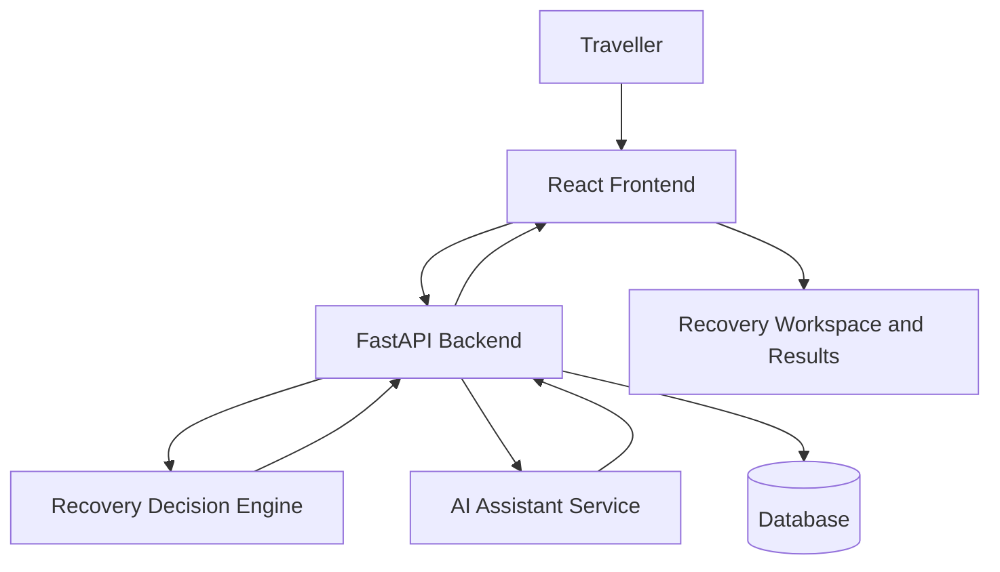

# 🚀 RouteRecover AI
### AI-Powered Travel Disruption Recovery & Intelligent Rerouting Platform

**Sahyadri DevHost 2026 / Synergia 26 Hackathon**  
**Problem Statement 4.1 — Open Innovation**

RouteRecover AI is an intelligent travel recovery platform designed to help travellers recover from unexpected disruptions such as cancelled flights, missed connections, and major delays.

The platform analyses travel requirements, evaluates alternative recovery options, considers traveller constraints, and generates ranked recommendations to support informed recovery decisions.

Instead of manually searching multiple websites, travellers can use a unified interface to understand disruptions, explore alternatives, and plan their next steps.

---

## 🌐 Live Deployment

| Service | Link |
|---|---|
| 🖥️ Live Application | [Open RouteRecover AI](https://sahyadri-hakathon-334o.vercel.app/) |
| ⚙️ Backend API | [Open Backend API](https://sahyadri-hakathon.onrender.com) |
| 📖 API Documentation | [Swagger API Docs](https://sahyadri-hakathon.onrender.com/api/docs) |
| 💻 GitHub Repository | [View Source Code](https://github.com/abhisheksuvarna782-coder/SAHYADRI-HAKATHON) |
| 🎥 Demonstration Video | **[PASTE GOOGLE DRIVE VIDEO LINK HERE]** |

---

## 🏆 1. Hackathon Information

| Detail | Information |
|---|---|
| Project Name | RouteRecover AI |
| Hackathon | Sahyadri DevHost 2026 / Synergia 26 |
| Problem Statement | 4.1 — Open Innovation |
| Institution | A.J. Institute of Engineering and Technology |
| Location | Mangaluru, Karnataka, India |
| Project Domain | Artificial Intelligence & Full-Stack Development |
| Project Type | Travel Disruption Recovery Platform |

**Built for the Sahyadri DevHost 2026 / Synergia 26 Hackathon**, RouteRecover AI explores how AI-assisted explanations, deterministic decision-making, and full-stack development can help travellers manage unexpected disruptions.

---

## 👥 2. Team Members & Responsibilities

| Team Member | Assigned Role |
|---|---|
| **Abhishek Suvarna** | Team Leader — Frontend Design & Backend Integration |
| **Rishitha R** | Backend Development & API Design |
| **Ajaya Raj A.N** | AI Decision Engine & Recovery Logic |
| **Ritu R Suvarna** | Testing, Quality Assurance & Demonstration Video |

The team collaborates to develop, integrate, test, and demonstrate the RouteRecover AI platform.

### Team Leader Links

- **GitHub:** [abhisheksuvarna782-coder](https://github.com/abhisheksuvarna782-coder)
- **LinkedIn:** [Abhishek Suvarna](https://www.linkedin.com/in/abhishek-suvarna-1bb2b6335/)

---

## 🎯 3. Problem Statement

Travel disruptions can turn a planned journey into a stressful and expensive experience. When a flight is cancelled or delayed, travellers often need to search multiple platforms to find alternative transport and manage existing bookings.

The challenge becomes more complicated when travellers have strict arrival deadlines, connecting journeys, hotel reservations, or limited budgets.

### Key Challenges

- Cancelled or delayed flights disrupt the entire travel itinerary.
- Finding alternative routes requires checking multiple platforms.
- Travellers may miss hotel check-ins, events, meetings, or onward connections.
- Alternative journeys may exceed the available budget.
- Recovery decisions must consider several constraints simultaneously.
- Travellers lack a unified view of disruption impacts and recovery options.

### Proposed Solution

RouteRecover AI transforms travel disruption into a structured recovery process by helping travellers organise their trips, identify disruptions, analyse affected bookings, evaluate alternatives, and find recovery plans that respect their requirements.

---

## 🌟 4. What Makes RouteRecover AI Different?

RouteRecover AI focuses on **constraint-aware travel recovery** rather than simply suggesting alternative routes.

| Feature | Description |
|---|---|
| 🧠 Constraint-Aware Planning | Considers deadlines, budgets, and itinerary requirements |
| 🤖 AI-Assisted Recovery | Combines deterministic decision-making with optional AI assistance |
| 🗂️ Centralised Workspace | Organises disruption information and recovery options |
| 💰 Budget-Conscious Decisions | Evaluates options against additional spending limits |
| ⏰ Deadline-Focused Planning | Considers required arrival times |
| 🔍 Explainable Recommendations | Helps users understand why options are selected or rejected |
| 👤 Human-Controlled Decisions | Allows travellers to review recovery recommendations |

---

## ⚙️ 5. How It Works


### Workflow

1. **Trip Setup:** The traveller creates or selects a trip.
2. **Constraint Collection:** The system records deadlines, budgets, and preferences.
3. **Disruption Handling:** A disruption is recorded or simulated.
4. **Impact Analysis:** The system evaluates affected bookings and itinerary dependencies.
5. **Alternative Evaluation:** Potential recovery options are generated.
6. **Constraint Checking:** Options are evaluated against mandatory requirements.
7. **Recommendation:** Feasible alternatives are ranked and presented.
8. **Decision:** The traveller reviews the results and selects a suitable recovery plan.

---

## 🏗️ 6. System Architecture



### Architecture Components

| Component | Technology | Purpose |
|---|---|---|
| Frontend | React and TypeScript | Interactive user interface |
| Build Tool | Vite | Frontend development and production builds |
| Styling | Tailwind CSS | Responsive interface design |
| API Communication | Axios | Frontend-backend communication |
| Routing | React Router | Application navigation |
| Backend | Python and FastAPI | API endpoints and application logic |
| Data Validation | Pydantic | Request and response validation |
| ORM | SQLAlchemy | Database interaction |
| Database | SQLite | Data storage |
| AI Integration | Configured AI provider | AI-assisted recovery explanations |
| Frontend Hosting | Vercel | Web application deployment |
| Backend Hosting | Render | Backend API deployment |

---

## ✨ 7. Key Features

### 📊 Dashboard
A centralised overview of trips, bookings, disruptions, and recovery activity.

### 🧳 Trip Management
Organise trip information, travel bookings, and itinerary details.

### 🚨 Disruption Centre
Record and manage travel disruptions, including flight cancellations, delays, and missed connections.

### 🤖 AI-Assisted Recovery
Analyse recovery requirements and provide assistance through decision logic and optional AI integration.

### 🗺️ Recovery Workspace
Explore recovery alternatives, compare options, and review the reasons behind recommendations.

### ⚙️ Traveller Constraints
Supports constraint-aware planning based on:

- Maximum additional spending
- Required arrival time
- Destination and travel preferences
- Existing itinerary commitments

### 💬 AI Assistant
Provides conversational assistance for travel recovery questions, subject to the configured AI provider and available fallback functionality.

### 📜 Recovery History
Review previous recovery activity and recorded decisions.

### 📱 Responsive Interface
Provides an application experience across desktop, tablet, and mobile screens.

### 🎨 Interactive User Experience
Includes interactive dashboard elements, visualisations, and application navigation.

---

## 🛠️ 8. Technology Stack

### Frontend
- React.js
- TypeScript
- Vite
- Tailwind CSS
- Axios
- React Router
- TanStack React Query
- Framer Motion
- Three.js and React Three Fiber, where configured

### Backend
- Python 3
- FastAPI
- Pydantic
- Pydantic Settings
- SQLAlchemy
- Uvicorn

### Database
- SQLite
- Database initialisation through the application configuration

### AI & Recovery Logic
- Deterministic recovery decision engine
- Booking and itinerary impact analysis
- Constraint-based filtering
- Alternative evaluation and ranking
- Optional OpenAI / Anthropic integration

### Deployment & Development
- Git and GitHub
- Vercel
- Render
- Environment-based configuration

---

## 🚀 9. Installation and Setup

### Prerequisites

- Git
- Node.js 18 or later
- npm
- Python 3.10 or later
- Visual Studio Code or another code editor

### Step 1 — Clone the Repository

```bash
git clone https://github.com/abhisheksuvarna782-coder/SAHYADRI-HAKATHON.git
cd SAHYADRI-HAKATHON
```

### Step 2 — Set Up the Backend

```bash
cd backend
python -m venv .venv
```

Activate the virtual environment.

**Windows:**

```bash
.venv\Scripts\activate
```

**macOS / Linux:**

```bash
source .venv/bin/activate
```

Install the backend dependencies:

```bash
pip install -r requirements.txt
```

Configure the required environment variables according to the project's configuration.

Start the backend server:

```bash
uvicorn app.main:app --reload --port 8000
```

Backend URL:

`http://localhost:8000`

API documentation:

`http://localhost:8000/api/docs`

### Step 3 — Set Up the Frontend

Open a new terminal from the repository root:

```bash
cd frontend
npm install
```

Create a `.env` file inside the `frontend/` directory:

```env
VITE_API_BASE_URL=http://localhost:8000
```

Start the frontend:

```bash
npm run dev
```

The frontend will generally be available at:

`http://localhost:5173`

**Note:** The commands above assume the repository uses the specified directory structure, scripts, and application entry point. Follow the actual project files if your configuration differs.

### Step 4 — Optional AI Configuration

Configure the supported AI provider credentials in the backend environment when AI-generated responses are required.

```env
AI_PROVIDER=none
OPENAI_API_KEY=
ANTHROPIC_API_KEY=
```

Set the provider value according to the application's implementation. Never commit real API keys, credentials, or secrets to GitHub.

---

## 🎥 10. Project Demonstration Video

The demonstration video will showcase the RouteRecover AI interface, travel disruption workflow, recovery engine, and key application features.

### Google Drive Video Link

**Paste your Google Drive link below:**

`[ADD GOOGLE DRIVE VIDEO LINK HERE]`

**Video:** [Watch the RouteRecover AI Demonstration](PASTE_GOOGLE_DRIVE_VIDEO_LINK_HERE)

> Replace the placeholder URL with the actual Google Drive sharing link after uploading the video. Ensure the sharing permissions allow hackathon evaluators to view it.

---

## 🧪 11. Demonstration Scenario

### Example: Cancelled Mangaluru–Bengaluru Flight

| Requirement | Example |
|---|---|
| Original Journey | Mangaluru → Bengaluru |
| Disruption | Flight cancellation |
| Hotel Reservation | Bengaluru hotel |
| Next Journey | Train to Mysuru |
| Train Departure | 5:00 PM |
| Required Arrival Deadline | 4:00 PM |
| Maximum Additional Spending | ₹1,500 |

The traveller needs to reach Bengaluru before the onward journey. RouteRecover AI evaluates possible alternatives against the time constraint, available budget, and itinerary requirements.

*This is an illustrative scenario. Travel alternatives, schedules, and prices should not be interpreted as live provider availability unless supported by active integrations.*

---

## 🔐 12. Reliability and Limitations

- **Demonstration Mode:** Some booking changes and travel recovery scenarios may be simulated.
- **Backend Cold Starts:** The Render deployment may take time to respond after inactivity.
- **Database Persistence:** SQLite persistence depends on the hosting environment and deployment configuration.
- **AI Availability:** AI-generated responses depend on provider configuration, credentials, and service availability.
- **Live Travel Data:** Real-time schedules, fares, and booking availability require appropriate external integrations.
- **Booking Execution:** Recommendations do not automatically guarantee or complete real-world reservations.

---

## 🔮 13. Future Enhancements

- Integration with live airline, railway, and bus availability APIs.
- Intelligent multimodal route planning.
- Real-time travel disruption monitoring.
- Automated notifications for significant disruptions.
- Improved booking-dependency analysis.
- Real booking and rebooking integrations.
- Enhanced explainable AI recommendations.
- Multilingual travel assistance.
- Mobile application support.
- Advanced recovery analytics and reporting.

---

## 🤝 14. Team Collaboration

RouteRecover AI is developed collaboratively for the **Sahyadri DevHost 2026 / Synergia 26 Hackathon**.

| Team Member | Primary Responsibility |
|---|---|
| **Abhishek Suvarna** | Team Leader — Frontend Design & Backend Integration |
| **Rishitha R** | Backend Development & API Design |
| **Ajaya Raj A.N** | AI Decision Engine & Recovery Logic |
| **Ritu R Suvarna** | Testing, Quality Assurance & Demonstration Video |

The team combines frontend engineering, backend development, AI-assisted decision-making, testing, and demonstration preparation to deliver the project.

---

## 📄 15. License

This project was developed for hackathon demonstration purposes. Refer to the repository's `LICENSE` file, if present, for applicable licensing terms.

---

## 🙌 Acknowledgements

Developed at **A.J. Institute of Engineering and Technology, Mangaluru**, for **Sahyadri DevHost 2026 / Synergia 26 Hackathon**.

We aim to explore practical applications of artificial intelligence, explainable decision-making, and full-stack software development to make travel disruption recovery more transparent and efficient.

---

<div align="center">

# ✈️ RouteRecover AI

### Recover Your Journey. Make Informed Decisions.

**Built with ❤️ for Sahyadri DevHost 2026 / Synergia 26 Hackathon.**

</div>
