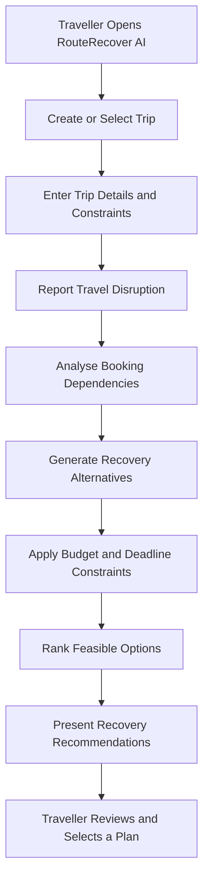
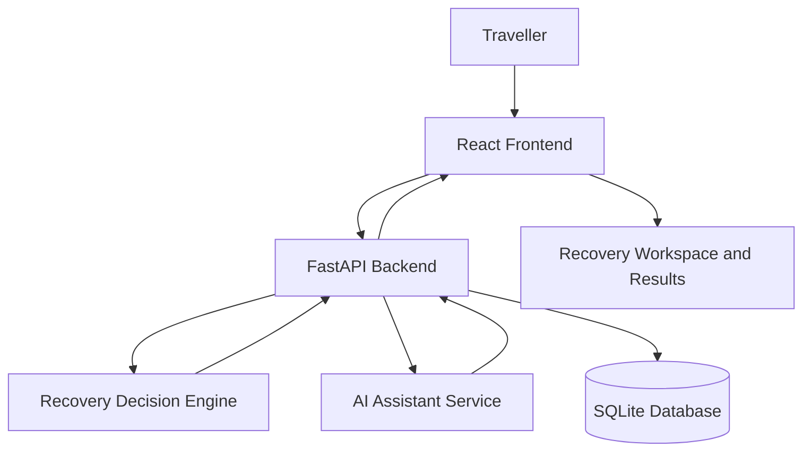

# 🚀 RouteRecover AI
### AI-Powered Travel Disruption Recovery & Intelligent Rerouting Platform

**Sahyadri DevHost 2026 / Synergia 26 Hackathon**  
**Problem Statement 4.1 — Open Innovation**

RouteRecover AI is an intelligent travel recovery platform designed to help travellers recover from unexpected disruptions such as cancelled flights, missed connections, and major delays.

The platform analyses travel requirements, evaluates alternative recovery options, and presents structured recommendations based on the traveller's schedule, budget, destination, and personal constraints.

Instead of manually searching multiple websites, travellers can use a unified interface to understand disruptions, explore alternatives, and make informed recovery decisions.

---

## 🌐 Live Deployment

| Service | Link |
|---|---|
| 🖥️ **Live Application** | [Open RouteRecover AI](https://sahyadri-hakathon-334o.vercel.app/) |
| ⚙️ **Backend API** | [Open Backend API](https://sahyadri-hakathon.onrender.com) |
| 📖 **API Documentation** | [Swagger API Docs](https://sahyadri-hakathon.onrender.com/api/docs) |
| 💻 **GitHub Repository** | [View Source Code](https://github.com/abhisheksuvarna782-coder/SAHYADRI-HAKATHON) |
| 🎥 **Project Demonstration Video** | **[ADD GOOGLE DRIVE VIDEO LINK HERE]** |

> **Note:** The backend is hosted on Render and may take 30–45 seconds to wake up after inactivity.

---

## 📌 1. Problem Statement

Travel disruptions can turn a planned journey into a stressful and expensive experience. When a flight is cancelled or delayed, travellers often need to search across multiple platforms to find alternative transport and manage existing bookings.

The challenge becomes more complicated when travellers have strict arrival deadlines, connecting journeys, hotel reservations, or limited budgets.

### ❌ Existing Challenges

- Cancelled or delayed flights disrupt the entire travel itinerary.
- Finding alternative routes requires checking multiple platforms.
- Travellers may miss hotel check-ins, events, meetings, or onward connections.
- Alternative journeys may exceed the available budget.
- Recovery decisions must consider multiple constraints simultaneously.
- Travellers lack a unified view of disruption impacts and recovery options.

### 💡 Our Solution

RouteRecover AI transforms travel disruption into a structured recovery process by helping travellers organise their trips, identify disruptions, analyse affected bookings, evaluate alternatives, and find recovery plans that respect their requirements.

---

## 🌟 2. What Makes RouteRecover AI Different?

RouteRecover AI focuses on **constraint-aware travel recovery** rather than simply suggesting alternative routes.

| Feature | Description |
|---|---|
| 🧠 Constraint-Aware Planning | Considers deadlines, budgets, and itinerary requirements |
| 🤖 AI-Assisted Recovery | Combines deterministic decision-making with optional LLM assistance |
| 🗂️ Centralised Workspace | Organises disruption information and recovery options |
| 💰 Budget-Conscious Decisions | Evaluates options against maximum additional spending |
| ⏰ Deadline-Focused Planning | Considers the traveller's required arrival time |
| 🔍 Explainable Recommendations | Helps users understand why options are selected or rejected |
| 👤 Human-Controlled Decisions | Allows travellers to review recovery recommendations |

---

## 🧠 3. How It Works



### Workflow Explanation

1. **Trip Setup:** The traveller creates or selects a trip.
2. **Constraint Collection:** The system records deadlines, budgets, and travel preferences.
3. **Disruption Handling:** A disruption is recorded or simulated.
4. **Impact Analysis:** The system evaluates affected bookings and itinerary dependencies.
5. **Alternative Evaluation:** Potential recovery options are generated.
6. **Constraint Checking:** Options are evaluated against mandatory requirements.
7. **Recommendation:** Feasible alternatives are ranked and presented.
8. **Decision:** The traveller reviews the results and selects a suitable recovery plan.

---

## 🏗️ 4. System Architecture



### Architecture Components

| Component | Technology | Purpose |
|---|---|---|
| Frontend | React + TypeScript | Interactive user interface |
| Build Tool | Vite | Frontend development and production builds |
| Styling | Tailwind CSS | Responsive interface design |
| API Communication | Axios | Frontend-backend communication |
| Routing | React Router | Application navigation |
| Backend | Python + FastAPI | API endpoints and application logic |
| Data Validation | Pydantic | Request and response validation |
| ORM | SQLAlchemy | Database interaction |
| Database | SQLite | Persistent data storage |
| AI Integration | OpenAI / Anthropic, when configured | AI-assisted recovery explanations |
| Frontend Hosting | Vercel | Web application deployment |
| Backend Hosting | Render | Backend API deployment |

---

## ✨ 5. Key Features

### 📊 Dashboard
A centralised overview of trips, bookings, disruptions, and recovery activity.

### 🧳 Trip Management
Organise trip information, travel bookings, and itinerary details.

### 🚨 Disruption Centre
Record and manage travel disruptions, including flight cancellations, delays, and missed connections.

### 🤖 AI-Assisted Recovery
Analyse recovery requirements and provide assistance through deterministic decision logic and optional LLM integration.

### 🗺️ Recovery Workspace
Explore recovery alternatives, compare options, and review the reasons behind recommendations.

### ⚙️ Traveller Constraints
Supports constraint-aware planning based on:

- Maximum additional spending
- Required arrival time
- Destination and travel preferences
- Existing itinerary commitments

### 💬 AI Assistant
Provides conversational assistance for travel recovery questions, with deterministic fallback behaviour when configured AI services are unavailable.

### 📜 Recovery History
Review previous recovery activity and recorded decisions.

### 📱 Responsive Interface
Provides a responsive application experience across desktop, tablet, and mobile screens.

### 🎨 Interactive User Experience
Includes animated interface elements, interactive visualisations, and an enhanced dashboard experience.

---

## 🎯 6. Demonstration Scenario

**Scenario: Cancelled Mangaluru–Bengaluru Flight**

| Requirement | Example |
|---|---|
| Original Journey | Mangaluru → Bengaluru |
| Disruption | Flight cancellation |
| Hotel Reservation | Bengaluru hotel |
| Next Journey | Train to Mysuru |
| Train Departure | 5:00 PM |
| Required Arrival Deadline | 4:00 PM |
| Maximum Additional Spending | ₹1,500 |

The traveller needs to reach Bengaluru before the onward journey. RouteRecover AI evaluates possible alternatives against the time constraint, available budget, and itinerary requirements.

*This is an illustrative demonstration scenario. The displayed travel alternatives and prices should not be interpreted as live provider availability.*

---

## 🛠️ 7. Technology Stack

### Frontend
- React.js
- TypeScript
- Vite
- Tailwind CSS
- Axios
- React Router
- Framer Motion
- TanStack React Query
- Three.js and React Three Fiber

### Backend
- Python 3
- FastAPI
- Pydantic
- Pydantic Settings
- SQLAlchemy
- Uvicorn

### Database
- SQLite
- Automatically initialised demonstration data

### AI & Recovery Logic
- Deterministic constraint-aware recovery engine
- Booking and itinerary impact analysis
- Alternative evaluation and ranking
- Optional OpenAI / Anthropic integration

### Deployment
- **Frontend:** Vercel
- **Backend:** Render
- **Version Control:** Git and GitHub

---

## ⚙️ 8. Installation and Setup

### Prerequisites

- Git
- Node.js 18 or later
- npm
- Python 3.10 or later
- A code editor such as Visual Studio Code

### Step 1 — Clone the Repository

```bash
git clone https://github.com/abhisheksuvarna782-coder/SAHYADRI-HAKATHON.git
cd SAHYADRI-HAKATHON
```

### Step 2 — Set Up the Backend

```bash
cd backend
python -m venv .venv
```

Activate the virtual environment.

**Windows:**

```bash
.venv\Scripts\activate
```

**macOS / Linux:**

```bash
source .venv/bin/activate
```

Install the dependencies:

```bash
pip install -r requirements.txt
```

Start the backend server:

```bash
uvicorn app.main:app --reload --port 8000
```

The backend API will be available at:

`http://localhost:8000`

API documentation:

`http://localhost:8000/api/docs`

### Step 3 — Set Up the Frontend

Open a new terminal from the repository root:

```bash
cd frontend
npm install
```

Create a `.env` file in the `frontend/` directory:

```env
VITE_API_BASE_URL=http://localhost:8000
```

Start the frontend:

```bash
npm run dev
```

The frontend will generally be available at:

`http://localhost:5173`

### Step 4 — Optional AI Configuration

Configure the appropriate AI provider credentials in the backend environment when real LLM responses are required.

```env
AI_PROVIDER=none
OPENAI_API_KEY=
ANTHROPIC_API_KEY=
```

Set `AI_PROVIDER` to the provider supported by your configuration when enabling an AI integration. Never commit real API keys or other secrets to GitHub.

---

## 🎥 9. Project Demonstration Video

The demonstration video showcases the application's interface, travel disruption workflow, recovery engine, and key features.

**Google Drive Video Link:**  
[ADD YOUR GOOGLE DRIVE VIDEO LINK HERE]

> Replace the placeholder with the shareable Google Drive URL after uploading the final demonstration video. Ensure the link permissions allow reviewers to view the video.

---

## 🔐 10. Reliability and Limitations

- **Demonstration Mode:** Booking changes and travel recovery scenarios may be simulated. The application does not automatically make real bookings or modify provider reservations.
- **Backend Cold Starts:** The Render free tier may take time to respond after inactivity.
- **Database Persistence:** SQLite persistence depends on the hosting environment and deployment configuration.
- **AI Availability:** Real LLM responses depend on the configured provider and valid credentials.
- **Live Travel Data:** Real-time schedules, fares, and provider availability require appropriate external integrations.

---

## 🚀 11. Future Enhancements

- Integration with live airline, railway, and bus availability APIs.
- Intelligent multimodal route planning.
- Real-time travel disruption monitoring.
- Automated notifications for significant disruptions.
- Improved booking-dependency analysis.
- Real booking and rebooking integrations.
- Enhanced explainable AI recommendations.
- Multilingual travel assistance.
- Mobile application support.
- Advanced recovery analytics and reporting.

---

## 👥 12. Project Contributions

- **Abhishek Suvarna** — Team Lead, Frontend Design & Backend Integration
- **Rishitha R** — Backend Development & API Design
- **Ajaya Raj A.N** — AI Decision Engine & Recovery Logic
- **Ritu R Suvarna** — Testing, Quality Assurance & Demonstration Video

### Team Lead Links

- **GitHub:** [abhisheksuvarna782-coder](https://github.com/abhisheksuvarna782-coder)
- **LinkedIn:** [Abhishek Suvarna](https://www.linkedin.com/in/abhishek-suvarna-1bb2b6335/)

---

## 🏛️ 13. Project Information

| Detail | Information |
|---|---|
| Project Name | RouteRecover AI |
| Institution | A.J. Institute of Engineering and Technology |
| Location | Mangaluru, Karnataka, India |
| Hackathon | Sahyadri DevHost 2026 / Synergia 26 |
| Problem Statement | 4.1 |
| Project Domain | AI-Powered Travel Recovery |

---

## 🤝 14. Contributing

Suggestions, feedback, and improvements are welcome.

1. Fork the repository.
2. Create a feature branch.
3. Implement and test your changes.
4. Commit your changes with a descriptive message.
5. Submit a pull request describing the improvement.

---

## 📄 15. License

This project was developed for hackathon demonstration purposes. No specific open-source license is declared in this README. Add an appropriate `LICENSE` file if the project is intended for public redistribution.

---

<div align="center">

### ✈️ RouteRecover AI

**Smarter Decisions When Travel Plans Go Wrong.**

Built with ❤️ for Sahyadri DevHost 2026 / Synergia 26 Hackathon.

</div>
