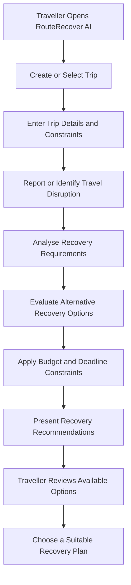
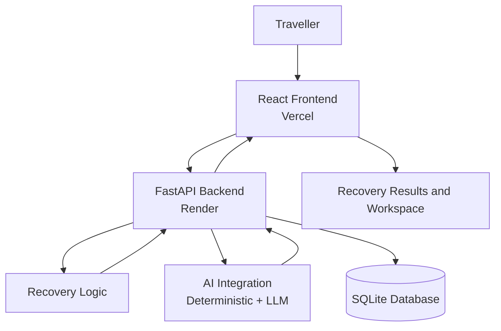

# 🚀 RouteRecover AI

> **AI-Powered Travel Disruption Recovery & Intelligent Rerouting Platform**

**Sahyadri DevHost 2026 / Synergia 26 Hackathon**
Problem Statement 4.1 | Team QuadCoders

RouteRecover AI is an intelligent travel recovery platform that helps travellers recover from unexpected disruptions such as cancelled flights, missed connections, and major delays. Instead of manually searching for alternatives, the platform explores recovery options based on the traveller's schedule, budget, destination, and personal constraints.

---

## 🌐 Live Deployment

| Service | URL |
|---------|-----|
| 🖥️ **Frontend (Vercel)** | [sahyadri-hakathon-334o.vercel.app](https://sahyadri-hakathon-334o.vercel.app/) |
| ⚙️ **Backend API (Render)** | [sahyadri-hakathon.onrender.com](https://sahyadri-hakathon.onrender.com) |
| 📖 **API Docs (Swagger)** | [sahyadri-hakathon.onrender.com/api/docs](https://sahyadri-hakathon.onrender.com/api/docs) |
| 💻 **GitHub Repository** | [github.com/abhisheksuvarna782-coder/SAHYADRI-HAKATHON](https://github.com/abhisheksuvarna782-coder/SAHYADRI-HAKATHON) |

> ⚠️ The backend runs on Render's free tier — it may take **30–45 seconds** to wake up after inactivity. Just wait and refresh.

---

## 📌 1. Problem Statement

Travel disruptions can turn a planned journey into a stressful and expensive experience. When a flight is cancelled or delayed, travellers often have to search across multiple websites to find alternative flights, trains, buses, accommodation, and transportation.

The challenge becomes harder when travellers have strict arrival deadlines, existing hotel reservations, connecting journeys, or limited budgets.

### ❌ Existing Challenges

- Cancelled or delayed flights disrupt the entire travel itinerary
- Finding alternative transport requires checking multiple platforms
- Travellers may miss hotel check-ins, events, meetings, or connecting journeys
- Alternative routes can exceed the traveller's budget
- Recovery decisions must consider multiple constraints simultaneously

### 💡 Our Solution

RouteRecover AI transforms travel disruption into a structured recovery process — helping travellers organise their trip, identify disruptions, evaluate alternatives, and find plans that respect budget, deadlines, and other constraints.

---

## 🌟 2. What Makes RouteRecover AI Different?

RouteRecover AI focuses on **constraint-aware travel recovery** rather than simply suggesting alternative routes.

| Innovation | Description |
|------------|-------------|
| 🧠 Constraint-Aware Planning | Considers deadlines, budgets, and itinerary requirements |
| 🤖 AI-Assisted Recovery | Deterministic + LLM-backed intelligent recovery logic |
| 🗂️ Centralised Workspace | All disruption details and recovery actions in one place |
| 💰 Budget-Conscious Decisions | Evaluates options against maximum additional spending |
| ⏰ Deadline-Focused Planning | Prioritises the traveller's required arrival time |
| 🎯 User-Centred Experience | Structured, clear interface for rapid decision-making |

---

## 🧠 3. How It Works



### Workflow Explanation

1. **Trip Setup** — The traveller enters or selects their trip details
2. **Constraint Collection** — Deadlines and spending limits are recorded
3. **Disruption Handling** — The disruption is logged in the recovery workflow
4. **Requirement Analysis** — The system evaluates the traveller's recovery needs
5. **Alternative Evaluation** — Possible travel recovery options are considered
6. **Constraint Checking** — Options are assessed against the traveller's requirements
7. **Recommendation** — Recovery information is presented for the traveller to review
8. **Decision** — The traveller selects an appropriate recovery plan

---

## 🏗️ 4. System Architecture



### Architecture Components

| Component | Technology | Purpose |
|-----------|-----------|---------|
| Frontend | React.js + TypeScript | User interface and interactive components |
| Build Tool | Vite | Frontend development and production builds |
| Styling | Tailwind CSS | Responsive interface styling |
| API Communication | Axios | HTTP communication with backend |
| Routing | React Router | Frontend navigation |
| Backend | Python FastAPI | API endpoints and backend operations |
| Data Validation | Pydantic | Request and response validation |
| ORM | SQLAlchemy | Database interaction |
| Database | SQLite | Persistent data storage |
| Frontend Deployment | Vercel | Live frontend hosting |
| Backend Deployment | Render | Live backend hosting |

---

## ✨ 5. Key Features

### 📊 Dashboard
Central place to view travel information, active trips, disruptions, and recovery metrics.

### 🧳 Trip Management
Organise trip details, bookings (flights, hotels, trains), and traveller information.

### 🚨 Disruption Centre
Record and handle travel disruptions including flight cancellations, delays, and missed connections.

### 🤖 AI-Assisted Recovery
Analyses travel requirements and evaluates alternatives using built-in deterministic intelligence and optional LLM support (OpenAI / Anthropic).

### 🗺️ Recovery Workspace
Brings disruption information and recovery options together in a structured, interactive workspace.

### ⚙️ Traveller Constraints
Supports constraint-aware planning for:
- Maximum additional spending
- Required arrival time
- Destination and travel preferences
- Existing itinerary commitments

### 💬 AI Assistant
Chat-based assistant with instant answers for common travel recovery queries — no API key required for demo mode.

### 📱 Responsive Interface
Works across desktops, tablets, and mobile devices.

---

## 🎯 6. Demonstration Scenario

**Scenario: Cancelled Mangaluru–Bengaluru Flight**

| Requirement | Details |
|-------------|---------|
| Original Journey | Mangaluru → Bengaluru |
| Disruption | IndiGo flight cancellation |
| Hotel Reservation | The Leela Palace, Bengaluru |
| Next Journey | Train to Mysuru |
| Train Departure | 5:00 PM |
| Required Arrival Deadline | 4:00 PM |
| Maximum Additional Spending | ₹1,500 |

The traveller must reach Bengaluru before 4:00 PM to manage the onward journey. RouteRecover AI evaluates alternatives (direct train, bus + metro, alternative flight) against both the time constraint and the ₹1,500 budget.

---

## 🛠️ 7. Technology Stack

### Frontend
- React.js + TypeScript
- Vite
- Tailwind CSS
- Axios
- React Router
- Framer Motion (animations)
- TanStack React Query

### Backend
- Python 3
- FastAPI
- Pydantic + Pydantic Settings
- SQLAlchemy
- Uvicorn

### Database
- SQLite (auto-seeded with demo data on startup)

### Deployment
- **Frontend** → Vercel (auto-deploy from GitHub)
- **Backend** → Render (auto-deploy from GitHub)

### AI & Recovery Logic
- Deterministic constraint-aware recovery engine (no API key needed)
- Optional: OpenAI / Anthropic LLM integration

---

## ⚙️ 8. Installation and Setup

### Prerequisites

- Git
- Node.js 18+ and npm
- Python 3.10+
- A code editor (VS Code recommended)

### Step 1 — Clone the Repository

```bash
git clone https://github.com/abhisheksuvarna782-coder/SAHYADRI-HAKATHON.git
cd SAHYADRI-HAKATHON
```

### Step 2 — Set Up the Backend

```bash
cd backend
python -m venv .venv

# Windows
.venv\Scripts\activate

# macOS/Linux
source .venv/bin/activate

pip install -r requirements.txt

# Run the backend
uvicorn app.main:app --reload --port 8000
```

The backend auto-seeds demo data on first startup. No manual database setup needed.

### Step 3 — Set Up the Frontend

Open a new terminal:

```bash
cd frontend
npm install
```

Create a `.env` file in the `frontend/` directory:

```env
VITE_API_BASE_URL=http://localhost:8000
```

Start the development server:

```bash
npm run dev
```

Vite will show the local URL (usually `http://localhost:5173`).

### Step 4 — Environment Variables (Production / Vercel)

For the deployed Vercel frontend, set this environment variable in the Vercel dashboard:

| Variable | Value |
|----------|-------|
| `VITE_API_BASE_URL` | `https://sahyadri-hakathon.onrender.com` |

No other frontend environment variables are required.

### Optional — AI Provider Keys (Backend)

Add these to a `backend/.env` file for real LLM responses (demo mode works without them):

```env
OPENAI_API_KEY=sk-...
# or
ANTHROPIC_API_KEY=sk-ant-...
```

---

## 🌐 9. Live Demo and Repository

| Link | URL |
|------|-----|
| 🖥️ Live Application | https://sahyadri-hakathon-334o.vercel.app/ |
| ⚙️ Backend API | https://sahyadri-hakathon.onrender.com |
| 📖 API Documentation | https://sahyadri-hakathon.onrender.com/api/docs |
| 💻 GitHub Repository | https://github.com/abhisheksuvarna782-coder/SAHYADRI-HAKATHON |

---

## 🔐 10. Reliability and Limitations

- **Demo Mode**: All booking changes are **simulated** — no real provider changes are made
- **Cold Starts**: Render free tier may take 30–45 seconds to wake up after inactivity
- **SQLite**: Database resets on fresh Render deploys; demo data is auto-seeded on startup
- **AI Responses**: Deterministic answers are provided in demo mode; real LLM responses require API keys

---

## 🚀 11. Future Enhancements

- **Live Travel API Integration** — Real transport schedules, fares, and availability
- **Intelligent Multimodal Routing** — Combine flights, trains, buses into one plan
- **Advanced Constraint Optimisation** — Rank plans using budget, arrival time, and preferences
- **Real-Time Disruption Monitoring** — Detect disruptions through external data sources
- **Mobile App** — Native iOS and Android experience
- **Booking Integration** — Support real booking workflows
- **Explainable AI** — Show reasoning behind each recovery recommendation

---

## 👨‍💻 12. Team QuadCoders

Developed by **Team QuadCoders** for **Sahyadri DevHost 2026 / Synergia 26 Hackathon**
at A.J. Institute of Engineering and Technology, Mangaluru.

| Team Member | Role | Responsibilities |
|-------------|------|-----------------|
| Abhishek Suvarna | Team Lead, Backend & AI | Team coordination, backend development, AI integration, and recovery logic |
| Rishitha R | Frontend Developer | UI development, frontend components, and user experience |
| Ajay Raj A N | Core Integration | Frontend-backend connectivity and system integration |
| Ritu R Suvarna | Research & Documentation | Problem research, documentation, and project presentation |

### 🔗 Team Lead Links
- GitHub: [github.com/abhisheksuvarna782-coder](https://github.com/abhisheksuvarna782-coder)
- LinkedIn: [linkedin.com/in/abhishek-suvarna-1bb2b6335](https://www.linkedin.com/in/abhishek-suvarna-1bb2b6335/)

### 🏛️ Project Information

| Detail | Information |
|--------|-------------|
| Project Name | RouteRecover AI |
| Team Name | QuadCoders |
| Institution | A.J. Institute of Engineering and Technology |
| Location | Mangaluru, Karnataka, India |
| Hackathon | Sahyadri DevHost 2026 / Synergia 26 |
| Problem Statement | 4.1 |

---

## 🤝 13. Contributing

Contributions, feedback, and suggestions are welcome.

1. Fork the repository
2. Create a feature branch (`git checkout -b feature/your-feature`)
3. Implement and test your changes
4. Commit with a descriptive message (`git commit -m "feat: your feature"`)
5. Open a pull request describing the improvement

---

## 📄 14. License

This project was built for hackathon demonstration purposes. No specific open-source license is declared. If you intend to distribute or reuse this project publicly, add an appropriate `LICENSE` file to the repository.

---

<div align="center">

⭐ **If you find RouteRecover AI interesting, give it a star on GitHub!**

**RouteRecover AI — Smarter decisions when travel plans go wrong. ✈️**

</div>